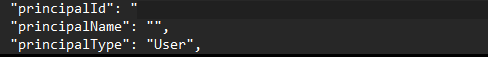
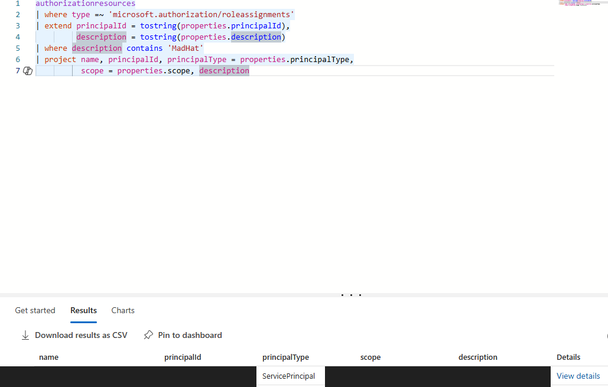
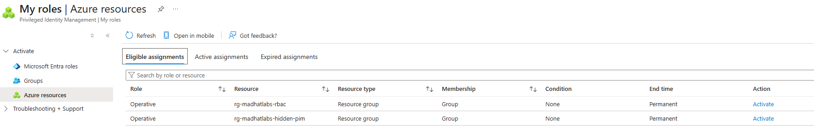
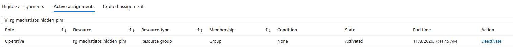
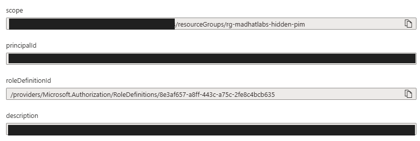

# The Privilege Audit

## Scope and methodology

I audited resource access in a live Azure tenant. I started with Reader-level access at assigned scopes and activated one PIM-eligible **Operative** role for the final check. I reviewed Azure RBAC for subscriptions, resource groups, and resources. Microsoft Entra directory roles were outside the scope.

I used four tools across five steps. I started with the IAM export for a baseline, used CLI for a repeatable scope check, used Resource Graph to search across visible scopes, and used PIM to compare eligible and active access. The final step combined PIM, Resource Graph, and an IAM export to verify a direct Owner grant.

| Method | What I used it for | What it can miss |
|---|---|---|
| IAM blade and export | Establish a baseline of active role assignments, including inherited grants. An export can include child scopes when selected and permitted. | Group rows do not expand into individual members. Unresolved identities can be easy to miss, and my account could not read assignments at subscription scope. |
| Azure CLI | Enumerate assignments at a known scope in a repeatable format. Compare principal IDs even when names are blank. | The resource-group command targets one group per run. A blank name alone cannot distinguish a deleted identity from a failed or unauthorized directory lookup. |
| Resource Graph with KQL | Search visible role assignments across Azure scopes in one query. Filter by principal ID, scope, or role definition. | The role-assignment query shows active grants visible to the caller. It does not show who is merely eligible, and an empty result can reflect limited visibility. |
| PIM export and Resource audit | Compare eligible and active assignments for the selected scope. Resource audit separately shows activation history, including who elevated, when, and recorded justification where available. | Coverage depends on scope and permissions. Cross-check ordinary RBAC grants in IAM because standing access can exist without a corresponding PIM activation record. |

## Findings by severity

| Severity | Finding                                                | Evidence and impact                                                                                                                                                                                                                                                                                                                                                                                                  |
| -------- | ------------------------------------------------------ | -------------------------------------------------------------------------------------------------------------------------------------------------------------------------------------------------------------------------------------------------------------------------------------------------------------------------------------------------------------------------------------------------------------------- |
| High     | Redundant Owner grants across scopes                   | The supplied IAM export showed one account with **64 direct Owner assignments** across **64 scopes**, including the subscription and 63 resource groups. The repeated pattern is consistent with scripted assignment, though the export does not establish how the grants were created. Removing the subscription grant alone would leave the resource-group grants in place.                                        |
| High     | Direct Owner grant on a restricted resource group      | After activating my Operative role, I found a separate direct Owner assignment in Resource Graph and corroborated it in the IAM export. The export recorded a condition on the assignment. I verified the grant and its scope, but could not establish its duration or whether the assignee still needed Owner. Treat it as potential standing privileged access until its lifecycle and business need are verified. |
| Medium   | Orphaned Reader assignment tied to a deleted principal | The supplied JSON showed a Reader grant on the production resource group with a populated principal ID and a blank name. The lab identified the user as deleted. The live checks under my account did not show that assignment. The known scope and read-only role limit the observed exposure, but the stale grant remains an offboarding gap.                                                                      |

**Why the orphan matters.** Azure stores the Entra object ID on the role assignment. Deleting the user leaves that grant behind. If the original soft-deleted user is restored, the grant still points to that same object. Creating a new account with the same name does not recreate the original identity. Microsoft also documents that valid, unexpired tokens can continue to carry access after deletion. Removing the stale assignment closes a path that would otherwise remain outside normal access reviews. 

## How I tested coverage

1. **IAM baseline.** The subscription IAM blade denied my account access to the assignment list. The supplied CSV let me compare direct grants at the subscription and resource-group scopes. Group membership was outside that export.
2. **CLI enumeration.** Cloud Shell returned three assignments for the Operative group at the production resource group. The supplied JSON exposed the additional orphaned Reader grant. I used its object ID as the pivot into Resource Graph.

   

3. **Resource Graph sweep.** Searching for that exact ID returned zero visible rows. A separate search of assignment descriptions returned a service principal at a storage-resource scope, which confirmed the query could see some assignments. The orphan’s existence came from the JSON evidence.
   


4. **PIM review.** I exported assignments for the lab’s RBAC resource group and reviewed eligible versus active access. Eligibility is the ability to request activation. An active grant provides permissions during its effective window. The export is a snapshot, while Resource audit is where I would check who activated a role and why. 
   
   

5. **The Hunt.** I activated the eligible Operative role for the hidden resource group and confirmed it under **Active assignments**. IAM initially returned no rows. I reused the Resource Graph query, filtering by the resource-group scope and the Owner role definition ID. The matching result and IAM CSV agreed on the assignee’s object ID and the direct Owner grant. My PIM activation provided the audit access. The Owner grant belonged to a separate principal.
   
   
   

### Reusable queries

The CLI command enumerates role assignments at the production resource group.

```powershell
az role assignment list --resource-group rg-madhatlabs-prod-cus
```

The Resource Graph query finds direct Owner assignments on a target resource group. Replace the group placeholder to reuse it. The GUID in the query identifies the built-in Owner role.

```kusto
authorizationresources
| where type =~ 'microsoft.authorization/roleassignments'
| extend scope = tostring(properties.scope),
         roleDefinitionId = tostring(properties.roleDefinitionId)
| where scope endswith '/resourceGroups/<resource-group-name>'
| where roleDefinitionId endswith '/8e3af657-a8ff-443c-a75c-2fe8c4bcb635'
| project scope, principalId = tostring(properties.principalId), roleDefinitionId
```

## Recommendations

- **Revoke orphaned assignments.** Confirm deletion using the principal ID, then remove the grant and verify it is gone. Add a RBAC cleanup step to offboarding.
- **Reduce redundant Owner access.** Replace broad grants with the narrowest job-function role at the narrowest scope. Trace the source of repeated grants so automation cannot reintroduce them.
- **Use PIM for human privilege.** Where elevated access is still needed, move standing grants to eligible assignments with MFA, justification, and a short activation window.
- **Assign routine access through managed groups.** Give each group an owner and review membership alongside the Azure grants it inherits.
- **Repeat the audit quarterly.** Turn each finding into a ticket with an owner, due date, and verification step. Track exceptions and confirm closure in the next audit.
